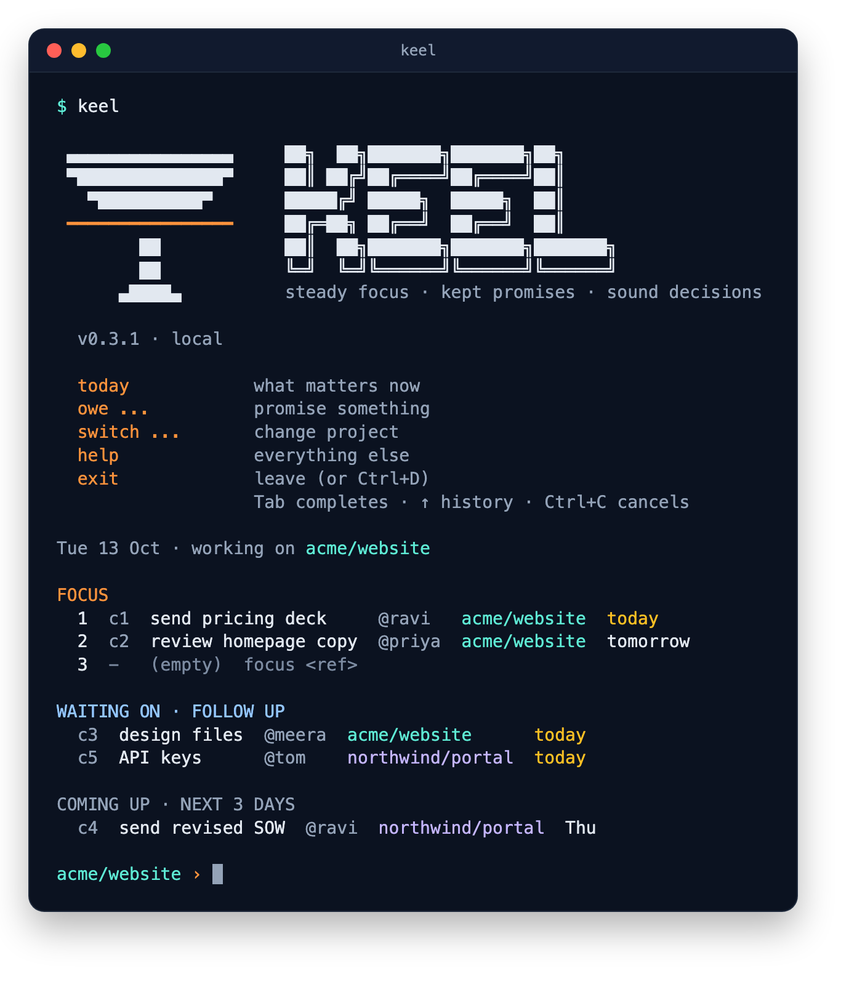
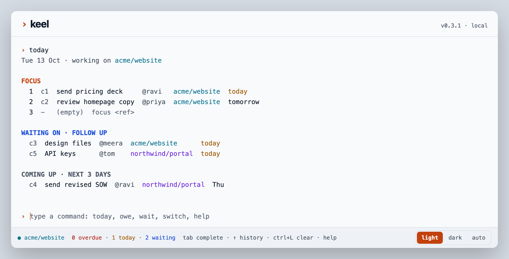

<p align="center">
  <picture>
    <source media="(prefers-color-scheme: dark)" srcset="assets/brand/keel-wordmark-dark.svg">
    
  </picture>
</p>

<p align="center">
  <a href="https://github.com/upadhyayprakash/keel/actions/workflows/ci.yml"></a>
  <a href="LICENSE"></a>
  <a href="https://nouisi-keel.mintlify.site"></a>
</p>

# Keel

A personal app for tracking promises, priorities, project context and decisions, so nothing promised is missed and focus stays on what matters. Built for people who juggle several clients and projects in the same week.

The name: a keel keeps a boat steady and on course. Keel does the same for the day: steady focus, kept promises, sound decisions.

<p align="center">
  
</p>
<p align="center"><em>The Keel shell in your terminal: just type <code>keel</code> (dark theme)</em></p>

<p align="center">
  
</p>
<p align="center"><em>The same terminal in your browser with <code>keel serve</code> (light theme)</em></p>

Status: v0.1.0 is on npm as [`@nouisi/keel`](https://www.npmjs.com/package/@nouisi/keel). See the [changelog](CHANGELOG.md) and the roadmap in the spec.

## What it does

- **Commitments:** "I owe" and "Waiting on", each with a person and a due date.
- **Today:** at most 3 priorities, plus anything due or overdue.
- **Clients and projects:** switch context in one command, with a resume note waiting for you.
- **Weekly review:** a guided walk through every open loop, ending with a week summary.
- **Terminal first, in two places:** the `keel` CLI, and the same terminal in your desktop browser (`keel serve`), with light and dark themes.
- **Your data, your database:** a local SQLite file, or a hosted libSQL database such as Turso.

## Quick start

Needs Node 20.19 or newer.

```bash
npm install -g @nouisi/keel
keel client new acme "Acme Corp"
keel project new acme/website "Website rebuild"
keel owe send pricing deck @ravi due:thu from:meeting
keel today
```

New to Keel? The [Get started guide](docs/get-started.md) walks from install to your first Friday review. Run `keel` on its own for the Keel shell (no `keel` prefix, Tab completion, history). Run `keel help` for every command, and `keel serve` for the browser terminal at http://localhost:4242 (desktop, localhost only).

Tab completion for people, projects, refs and dates:

```bash
echo 'eval "$(keel completion zsh)"' >> ~/.zshrc     # or: keel completion bash >> ~/.bashrc
```

## Your data

- It lives in `~/.keel/keel.db`. Change it with `KEEL_DB_URL` (see `.env.example`).
- Use it on several devices: `keel db connect libsql://<your-database>` keeps a synced copy on each one ([guide](docs/get-started.md#use-keel-on-several-devices), [ADR 0001](docs/adr/0001-multi-device-sync.md)).
- Keel writes a full JSON backup to `~/.keel/backups/` once a day and keeps the last 14 (`KEEL_BACKUP_KEEP`, `0` turns it off).
- `keel export > keel-backup.json` exports everything, `keel import keel-backup.json` restores it into an empty database, and `keel export --md` gives a readable snapshot.
- Add `--json` to any command for machine-readable output.

## Development

```bash
pnpm test           # all tests
pnpm typecheck
pnpm dev:server     # API on :4242, in one terminal
pnpm dev:web        # browser terminal with hot reload on :5173, in another
pnpm db:generate    # new migration after editing packages/core/src/db/schema.ts
pnpm keel <command> # run Keel from source
pnpm build          # browser terminal, then the npm bundle in apps/cli/dist
```

| Package | What it is |
|---|---|
| `packages/core` | Commands, parser, output blocks, database schema and migrations |
| `apps/cli` | The `keel` command (published as `@nouisi/keel`), renders blocks as terminal text |
| `apps/server` | Small local API behind `keel serve` |
| `apps/web` | The browser terminal |

## Docs

**User docs: [nouisi-keel.mintlify.site](https://nouisi-keel.mintlify.site)** (install, guides, every command).

- [Get started](docs/get-started.md): install, the ideas behind Keel, and the commands you'll use daily
- [Docs site source](docs-site/) (Mintlify): `pnpm docs:dev` to preview; `pnpm docs:generate` after changing commands or the changelog
- [01. Analysis](docs/01-analysis.md): how high-output people manage commitments, and the proposed app shape
- [02. Spec](docs/02-spec.md): v1 scope, data model, command language, architecture and user flows
- [Architecture decisions](docs/adr/README.md)
- [Changelog](CHANGELOG.md)

## License

[MIT](LICENSE)
